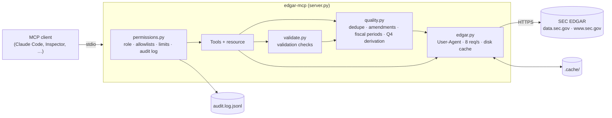

# edgar-mcp

An MCP server that brings SEC EDGAR financial filings into Claude and other MCP clients.
Every number it returns says exactly which filing it came from, data-quality problems are
reported instead of hidden, and a role-based permission layer controls what each client can
reach.

It runs locally over stdio, needs no API keys, and only talks to `sec.gov`.

 <!-- TODO: record a demo GIF -->

## Quick start

You need Python 3.12+ and [uv](https://docs.astral.sh/uv/) (`pip install uv` works fine).

```bash
git clone https://github.com/ccleader477/edgar-mcp.git
cd edgar-mcp
uv sync                     # or: python -m uv sync
cp .env.example .env        # Windows: copy .env.example .env
```

Edit `.env` and set `SEC_USER_AGENT` to your name and email. The SEC requires this on every
request, and the server refuses to start without it:

```
SEC_USER_AGENT=Jane Doe jane@example.com
```

Check that everything works:

```bash
uv run pytest -q            # 84 tests, all offline
```

### Use it in Claude Code

The repo ships a `.mcp.json`, so just open Claude Code in the project folder:

```bash
claude
```

Run `/mcp` and confirm `edgar` is connected with 4 tools. Then ask something like
*"What was Apple's revenue last quarter?"*

The `.mcp.json` launches the server with `python -m uv run python -m edgar_mcp.server`, which
works even when `uv` isn't on your PATH.

### Use it in another MCP client

Point the client at the same command, with the repo as the working directory:

```json
{
  "mcpServers": {
    "edgar": {
      "command": "python",
      "args": ["-m", "uv", "--directory", "/path/to/edgar-mcp", "run", "python", "-m", "edgar_mcp.server"],
      "env": { "EDGAR_MCP_ROLE": "analyst" }
    }
  }
}
```

### Try it in the MCP Inspector

```bash
uv run mcp dev src/edgar_mcp/server.py
```

## Architecture



| Module | Responsibility |
|---|---|
| `edgar.py` | HTTP client: User-Agent, rate limit, on-disk cache, ticker → CIK, section extraction |
| `models.py` | Pydantic models: `Fact`, `Provenance`, `CheckResult` |
| `quality.py` | Turns raw XBRL company facts into clean, deduplicated, fiscal-period-aware values |
| `validate.py` | Filing-specific validation checks |
| `permissions.py` | Roles, allowlists, per-call limits, JSONL audit log |
| `server.py` | FastMCP server: the tools and the resource |

## Tools

| Tool | What it does |
|---|---|
| `search_filings(ticker, form_types, limit, filed_after)` | Lists a company's filings, newest first: form, accession number, filed date, period end, document URL |
| `get_financial_facts(ticker, metrics, fiscal_years, period)` | Reported XBRL values, annual (`"annual"`), quarterly (`"quarterly"`) or both (`"all"`) |
| `get_filing_section(ticker, item, accession_number, max_chars, offset)` | Text of a 10-K's Item 1A (Risk Factors) or Item 7 (MD&A), pageable |
| `validate_financials(ticker, fiscal_year)` | Runs the validation checks below for one fiscal year |

**Resource:** `edgar://{cik}/{accession}` returns the full text of a filing's main document.

`get_financial_facts` accepts friendly metric names (`revenue`, `cost_of_revenue`,
`gross_profit`, `operating_income`, `pretax_income`, `income_tax`, `net_income`,
`eps_diluted`, `diluted_shares`, `operating_cash_flow`, `capex`,
`depreciation_amortization`, `stock_based_compensation`, `total_assets`,
`total_liabilities`, `stockholders_equity`, `cash`, `long_term_debt`,
`shares_outstanding`) or any raw `us-gaap` concept name, such as
`ResearchAndDevelopmentExpense`.

### What every number comes with

Each value carries its provenance: `accession_number`, `form`, `filed_date`, `concept`,
`unit`, `period_start`, `period_end` and `source_url`. Values that were calculated rather than
reported are marked `derived: true`, with the formula and the provenance of each input.

Example (Apple, fiscal Q4 2026):

```json
{
  "value": 114477000000.0,
  "unit": "USD",
  "fiscal_year": 2026,
  "fiscal_period": "Q4",
  "period_start": "2026-06-28",
  "period_end": "2026-09-26",
  "provenance": {
    "accession_number": "0000320193-26-000026",
    "form": "10-K",
    "filed_date": "2026-11-03",
    "concept": "RevenueFromContractWithCustomerExcludingAssessedTax",
    "source_url": "https://www.sec.gov/Archives/edgar/data/320193/000032019326000026/"
  },
  "derived": true,
  "derivation": "FY − (Q1+Q2+Q3)"
}
```

### Data quality

- **Duplicates collapsed.** XBRL repeats the same fact across many filings. The server keeps
  the most recently filed value per concept, unit and period, and flags `restated: true`
  when a later filing changed it.
- **Amendments win.** `10-K/A` and `10-Q/A` values replace the originals they amend.
- **Real quarters.** 10-Q year-to-date figures are converted to discrete quarters, and Q4 is
  derived as the full year minus Q1–Q3.
- **Real fiscal years.** Non-calendar years are handled from the filings' own period dates
  (Apple ends in September, Microsoft in June).
- **Nothing hidden.** Problems come back as structured `warnings` in the result instead of
  being dropped.

## Validation checks

`validate_financials` returns one result per check, each with a status (`pass`, `warn` or
`fail`), a plain-language detail and the facts it used. A check that can't run because data is
missing returns `warn`, never a silent pass.

| Check | What it verifies | Threshold |
|---|---|---|
| `balance_sheet_identity` | Assets = liabilities + equity (including noncontrolling and temporary equity) | within 0.5% |
| `quarters_sum_to_annual:revenue` | Quarters reconcile to the annual figure; reported quarters cross-checked against H1 and 9-month totals | within 0.5% |
| `quarters_sum_to_annual:net_income` | Same, for net income | within 0.5% |
| `quarters_sum_to_annual:operating_cash_flow` | Same, for operating cash flow | within 0.5% |
| `gross_profit_identity` | Gross profit = revenue − cost of revenue | within 0.5% of revenue |
| `sign_and_range` | Revenue isn't negative; tax rate, gross margin and net margin are plausible | tax 0–50%, gross margin −50–100%, net margin −100–100% |
| `yoy_change` | Flags big year-over-year swings to verify before use | > 50% change |
| `format_checks` | CIK and accession numbers are well-formed, and form types are known | — |

## Permission model

Permissions live in [`config/roles.yaml`](config/roles.yaml). The active role comes from the
`EDGAR_MCP_ROLE` environment variable (default `analyst`).

| Role | Can use |
|---|---|
| `analyst` | Everything: all four tools and the filing-document resource |
| `viewer` | Numbers and validation only: `get_financial_facts`, `validate_financials` |

On top of the role:

- **Ticker allowlist:** about 30 large caps (AAPL, MSFT, GOOGL, AMZN, NVDA, JPM, …) plus
  CELH. Set `tickers: ["*"]` to allow any SEC-registered company.
- **Form-type allowlist:** 10-K, 10-Q, 8-K (each with amendments), 20-F, 40-F, DEF 14A.
- **Per-call limits:** 50 filings, 15 metrics, 10 fiscal years and 50,000 characters of
  filing text.
- **Audit log:** every call, allowed or denied, is appended to `audit.log.jsonl` (override
  the path with `EDGAR_MCP_AUDIT_LOG`).

Denied calls return a clear error saying why.

## Safety

- **Read-only.** No tool writes, deletes or sends anything, apart from the local cache and
  audit log.
- **Untrusted filing text.** Text from filings is wrapped in
  `<filing_text source="...">…</filing_text>` tags, and the tool descriptions tell the
  model to treat it as data, never as instructions.
- **SEC etiquette.** Every request sends your `SEC_USER_AGENT`, requests are capped at 8 per
  second, and responses are cached in `.cache/`.
- **No secrets in git.** `.env`, the cache and the audit log are all gitignored.

## Configuration

| Variable | Required | Default | Purpose |
|---|---|---|---|
| `SEC_USER_AGENT` | yes | — | `Name email@example.com`, sent to the SEC on every request |
| `EDGAR_MCP_ROLE` | no | `analyst` | Which role from `config/roles.yaml` to use |
| `EDGAR_MCP_AUDIT_LOG` | no | `audit.log.jsonl` | Where to write the audit log |

Variables can be set in `.env` in the project root or in the environment; the environment
wins.

## Development

```bash
uv run pytest -q            # tests (offline, using saved fixtures)
uv run ruff check .         # lint
uv run ruff format .        # format
uv run mypy src             # types (strict)
```

Tests never touch the network: they use the SEC snapshots in `tests/fixtures/` and `respx`
mocks. To refresh the snapshots, run `uv run python scripts/fetch_fixtures.py` and commit the
result.

```
src/edgar_mcp/   edgar.py, models.py, quality.py, validate.py, permissions.py, server.py
config/          roles.yaml
tests/           tests and fixtures
scripts/         fetch_fixtures.py
```

## Data source

All data comes from SEC EDGAR's public APIs (`data.sec.gov`) and archives
(`www.sec.gov/Archives`). This project isn't affiliated with the SEC, and its output isn't
investment advice.
